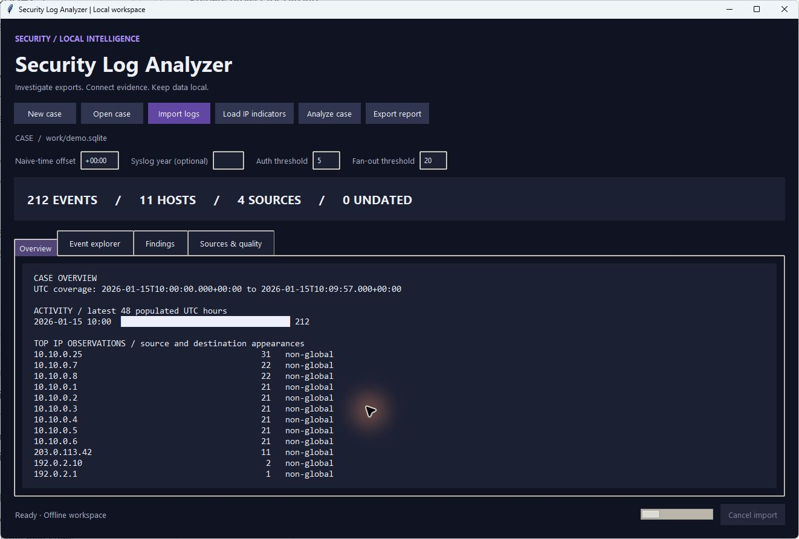

# Security Log Analyzer

Investigate security exports locally. Import Windows EVTX/ETL, CEF/LEEF, IIS/W3C, nested JSON, Sentinel and Defender exports, Syslog, and firewall logs into a SQLite case, correlate activity, inspect evidence, and export reports.

This is a native Python/Tk desktop application with a command-line interface. It makes no network requests and has no external runtime packages. Version 0.3.0 adds dedicated CEF/LEEF and IIS/W3C parsing plus streaming nested JSON imports. It is a triage tool, not a replacement for a SIEM or a forensic suite.



## Download

[Download Windows x64 portable ZIP](https://github.com/DBANFD/security-log-analyzer/releases/latest/download/Security-Log-Analyzer-v0.3.0-windows-x64.zip) | [All release assets](https://github.com/DBANFD/security-log-analyzer/releases/latest) | [Build status](https://github.com/DBANFD/security-log-analyzer/actions)

Extract the complete ZIP and run **SecurityLogAnalyzer.exe**. No Python installation is required. Keep the `_internal` folder beside the executables. The bundle also includes `security-log-analyzer-cli.exe`, synthetic samples, and documentation. Downloads are unsigned. Each release includes a source ZIP, a synthetic HTML report, and SHA-256 checksums.

## Run from source on Windows

Install Python 3.11 or later with Tcl/Tk support and the Python launcher. Double-click **launch.cmd**, or run this from the project folder:

```powershell
py -3 -m security_log_analyzer
```

No package installation is needed. On macOS/Linux use `python3 -m security_log_analyzer`; your Python distribution must include Tk for the GUI. CLI commands do not require Tk. The desktop interface is designed for a display of at least 1200 by 720 logical pixels.

1. Select **New case** and save a `.sqlite` file outside the repository.
2. Set the timezone offset for timestamps that lack an explicit offset. Default: `+00:00` (UTC).
3. Select **Import logs** and choose one or more exports.
4. Review **Sources & quality**, including rejected, undated, and assumed-time counts.
5. Select **Analyze case**. Inspect **Findings**, then double-click a finding to see events for its IP.
6. Export a whole-case HTML/JSON report, or a CSV of all events matching the applied explorer filters.

## Try the synthetic demo

The `samples/` directory contains only generated demonstration data. Import the four original log files listed below, load `samples/indicators.txt`, then analyze. Expected results: 212 events, one authentication burst across two source files, one destination fan-out group, and two local indicator matches. Use offset `+00:00` for the demo firewall file. The optional `windows-demo.xml` adds two more events: a Security 4625 event and a Sysmon network event.

```powershell
py -3 -m security_log_analyzer import cases/demo.sqlite samples/defender-demo.csv samples/sentinel-demo.jsonl samples/syslog-demo.log samples/firewall-demo.log
py -3 -m security_log_analyzer gui --case cases/demo.sqlite
py -3 -m security_log_analyzer report cases/demo.sqlite reports/demo.html --indicators samples/indicators.txt
```

Create the `reports` directory first. Reports can be opened offline; HTML reports support browser printing to PDF.

## Features

- Streaming imports, 2,000-event insert batches, disk-backed SQLite queries, and paginated event browsing.
- Dedicated CEF 0/1 and LEEF 1.0/2.0 parsers, including escaped CEF headers/values and declared LEEF delimiters.
- IIS/W3C parsing with changing `#Fields` headers, UTC timestamps, request/status fields, and original source lines.
- Streaming JSON arrays, common export containers, nested field mapping, and optional JSON Pointer selection. Nested JSONL records are also supported.
- Auto-detection inside `.log` files, with explicit format selection in the desktop and CLI. Malformed CEF/LEEF/W3C lines are retained with parse warnings.
- Windows `.evtx` decoding through Windows EventLogReader, including available System metadata, named payloads, and message text.
- Windows `.etl` best-effort decoding through local `tracerpt` conversion to a temporary EVTX file, followed by the same event reader. Temporary conversion requires additional disk space and is cleaned up on completion/cancellation.
- Portable Windows Event `.xml` and `.xml.gz` import, plus `.tsv` tables.
- Provider, event ID, channel, source record ID, and decode-warning fields; exact provider/event-ID filters in the GUI and CLI.
- CSV with comma, semicolon, or tab delimiters; quoted multiline CSV fields; UTF-8 with optional BOM.
- JSONL/NDJSON, basic RFC 3164/RFC 5424-style Syslog, and `key=value` firewall records. Optional gzip for each input format.
- Field normalization for common Sentinel/Defender columns, ISO 8601 and Unix epoch timestamps, IPv4 and IPv6.
- Hourly activity overview, top IP observations, text/IP/time filtering, and full retained record inspection.
- Authentication bursts, destination fan-out, and user-provided local IP/CIDR indicator matches.
- Cross-file correlation by source IP and five-minute UTC bucket, with source count and evidence event ID.
- SHA-256 source fingerprints, duplicate-file blocking, import quality statistics, and per-file rollback on cancellation or fatal parse errors.
- Escaped HTML reports, structured JSON reports, and CSV exports with formula-leading values neutralized.

## Input contract and mappings

See [docs/FORMATS.md](docs/FORMATS.md) and [docs/STRUCTURED-LOGS.md](docs/STRUCTURED-LOGS.md) for mappings, examples, and limits. CSV headers are required. JSON supports single objects, arrays, and common export containers; use **JSON path** for an unfamiliar or ambiguous container. JSONL uses one object per line. Text with no recognized structure is retained as a message with an unknown timestamp.

The database retains a JSON serialization of each source record. This is not a byte-for-byte preservation of the original export. Keep original files separately; their SHA-256 values are recorded. CSV record numbers are logical record positions including the header, not physical line numbers when fields span lines. Blank text lines are ignored.

CEF/LEEF/W3C retain `raw_line` and their parsed header/attributes. Nested JSON retains each original selected object and its path; wrapper metadata is not copied into every event. Warning counts use the existing `decode_warnings` storage field and now cover parse and decoding problems. Version 0.3 uses the same case schema as 0.2.

## Structured log quick start

Leave **Input format** on `auto` for typical files. Use `cef`, `leef`, `w3c`, `json`, or `jsonl` to override detection for a `.log` file; `text` disables structured text detection. Leave **JSON path** blank for automatic array selection, or enter a JSON Pointer such as `/data/events`; `$` selects the whole root. Clear the JSON path before importing non-JSON files.

```powershell
py -3 -m security_log_analyzer import cases/structured.sqlite samples/appliance-demo.cef samples/appliance-demo.leef samples/iis-demo.log samples/nested-demo.json
py -3 -m security_log_analyzer import cases/custom.sqlite export.json --json-path /payload/events
py -3 -m security_log_analyzer import cases/web.sqlite access.log --format w3c
```

The four new synthetic fixtures produce nine events with no rejected/undated records or parse warnings. The W3C 401/404 examples are HTTP outcomes, not proof of compromise and not inputs to the authentication-burst rule.

## Rules and interpretation

| Rule | Default trigger | Meaning |
| --- | --- | --- |
| `AUTH_BURST` | At least 5 failure-indicator events from one source IP in a fixed 5-minute UTC bucket | Authentication activity worth reviewing; legitimate retries can trigger it |
| `DEST_FANOUT` | At least 20 distinct destination IPs from one source IP in a fixed 5-minute UTC bucket | Possible scanning or normal service activity |
| `LOCAL_IOC` | Source or destination IP matches a supplied IP/CIDR | Match against your list, not an independently verified malicious verdict |

Thresholds are editable. For generic text/tabular/JSON input, authentication recognition uses specific strings such as `LogonFailed`, `Failed password`, and event ID `4625` in normalized action/message fields. For native Windows/XML events, it requires event ID `4625` from `Microsoft-Windows-Security-Auditing`, because IDs are provider-specific. CEF/LEEF require failure text; their vendor-specific numeric IDs alone do not count. W3C events are excluded from authentication-burst counting. Firewall denies alone do not count. This does not cover every authentication schema or status code.

Fixed buckets are not sliding windows: activity spanning a boundary can be missed. Undated records remain searchable and participate in IOC matching but are excluded from timed rules. NAT, proxies, and shared addresses can merge unrelated activity. Public/global address scope is not a reputation signal. No findings does not prove the data is clean. Each rule displays at most 1,000 matching groups/addresses and adds a limit notice if truncated.

Reports cover the whole case. Event-view filters apply only to event browsing and CSV export. CSV export uses the last **applied** filters and includes all matching events, not just the current page. Timestamp bounds are inclusive; a date alone means midnight at the beginning of that date. All time filters without offsets are UTC. The hourly overview shows the latest 48 populated hours, not necessarily 48 consecutive hours.

## Command line

```powershell
py -3 -m security_log_analyzer import cases/investigation.sqlite export.csv firewall.log.gz --offset +01:00
py -3 -m security_log_analyzer import cases/investigation.sqlite legacy-syslog.log --syslog-year 2026 --offset +01:00
py -3 -m security_log_analyzer summary cases/investigation.sqlite
py -3 -m security_log_analyzer report cases/investigation.sqlite reports/findings.json --failure-threshold 8 --fanout-threshold 30 --indicators local-indicators.txt
py -3 -m security_log_analyzer export cases/investigation.sqlite reports/filtered.csv --ip 203.0.113.42 --start 2026-01-15T10:00:00Z --end 2026-01-15T10:05:00Z
```

Use a text file containing one IP or CIDR per line for indicators. `#` starts a comment. Up to 10,000 entries are accepted. Indicator lists are loaded locally and must be reloaded when reopening a case. Report configuration includes the list used. Case data and reports are not encrypted by this application; use an appropriate local storage location and access controls.

## Large exports

EVTX/ETL import requires Windows, Windows PowerShell, and (for ETL) `tracerpt.exe`. Readable input files normally do not require elevation. The app neither elevates nor changes logging channels, running traces, execution policy, or provider registrations. Missing provider message resources are reported as decode warnings; retained metadata and available payloads remain searchable. All ETL events carry a best-effort warning because conversion cannot guarantee complete provider decoding. WPP/TMF/PDB-based traces, packet traces, and proprietary provider formats may expose only partial data. No symbol downloads or automatic provider installation are performed. See [docs/WINDOWS-EVENTS.md](docs/WINDOWS-EVENTS.md).

Existing v0.1 cases are upgraded transactionally to schema 2 when opened. Events and source records are preserved; new metadata columns are blank for old imports. Keep a backup before moving between application versions. Version 0.1 cannot read upgraded cases.

Imports do not load a whole file into memory. Data is inserted in batches inside a single per-file transaction. Memory and disk requirements depend on record size, index size, and group cardinality. Allow several times the input size for raw-record storage, indexes, rollback journals, and temporary SQL sorting. Gzip is fingerprinted as compressed bytes and parsed as a stream. Fingerprinting adds one full sequential read before ingestion.

The GUI performs imports, analysis, searches, and report exports on a worker thread. Import cancellation rolls back the current file; earlier completed files remain. Large SQL analyses cannot currently be cancelled from the UI. Only one app operation runs at a time. Use one app instance per case. Re-importing the same bytes is blocked, but overlapping exports with different fingerprints can duplicate events and inflate findings.

Records above 1 MiB of text are rejected in JSONL/text input; CSV field sizes are limited and excessive fields can cause the entire file to roll back. XML is read incrementally, retaining one event subtree; events above 1 MiB after XML serialization are rejected. Native Windows decoder transport records above 8 MiB are rejected. The parser holds one record and one insert batch, so unusually large records increase memory use. This version has no arbitrary fixed maximum file size, but multi-gigabyte real-world files have not yet been validated. See [docs/VALIDATION.md](docs/VALIDATION.md) for measured checks.

JSON documents are read in 64 KiB chunks. Selected JSON values above 1,048,576 characters, excessive nesting, duplicate keys, invalid syntax, or ambiguous automatic arrays roll back the entire file. Selected scalar array items are counted as rejected records. JSONL malformed lines are counted as rejected while valid lines remain importable. No third-party streaming package is required.

## Development and GitHub

```powershell
py -3 -m unittest discover -s tests -v
py -3 tools/generate_demo.py
```

The GitHub Actions workflow runs tests on Windows and Ubuntu with Python 3.11, 3.13, and 3.14. A workflow file is included; hosted CI results only exist after publication. Runtime dependencies are standard-library only. Optional installation with `pip install .` uses setuptools as a build dependency.

See [docs/GITHUB.md](docs/GITHUB.md) for publication steps. Case databases, local memory, and common export files are ignored by Git; ignore rules are not a substitute for checking staged files. Only synthetic fixtures belong in the repository. This project is prepared under the MIT license.
