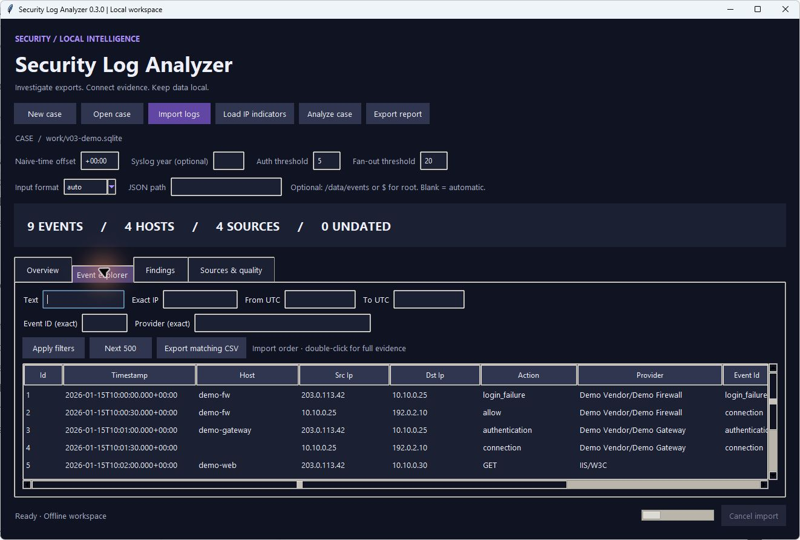

# Structured security, web, and JSON logs

## Selection and provenance

The default `auto` mode recognizes CEF/LEEF markers at token boundaries inside text/Syslog lines. W3C parsing activates on `#Fields`, `#Software`, or `#Version` directives. Dedicated extensions `.cef`, `.leef`, and `.w3c` select their parser directly. Auto does not infer JSON from arbitrary `.log` content: select `json` or `jsonl` explicitly. Gzip is supported for every text format.

The desktop's **Input format** control and CLI `--format` select `auto`, `text`, `cef`, `leef`, `w3c`, `json`, or `jsonl`. `text` keeps the earlier plain/Syslog/key-value reader. EVTX/ETL/XML must use `auto`. The selected settings apply to the next import; they do not reparse an existing case. A file's original fingerprint still blocks repeat import into the same case, so use a fresh case to compare parser choices.

CEF/LEEF/W3C preserve `raw_line` plus parsed headers/attributes. JSON preserves `original` plus `json_path` for each selected event. Inspect these by double-clicking an event. Wrapper metadata such as export pagination and totals is validated but not attached to every event; keep the original export. Unknown/custom fields are available in raw evidence, but the text search covers normalized message/identity/provider fields rather than arbitrary raw JSON.

## CEF

Supports CEF versions 0 and 1 with the seven standard header fields. Header pipes/backslashes and extension equals/backslashes/newlines are unescaped according to CEF conventions. Space-containing extension values remain intact until the next `key=` boundary. Quotes have no special escaping meaning. Unknown escape sequences remain literal. Duplicate extension keys keep the first value and add a warning; the source line retains every value.

Mapped fields: vendor/product to provider, signature/event ID to event ID, header severity or `sev`, `src`/`dst`, `dvchost` (then `dhost`/`shost`), `suser`/`duser`, `act`, and `msg`. Device times use `devTime`, then `rt`, `end`, or `start`; otherwise a recognized Syslog prefix supplies time. An explicit but invalid device timestamp remains undated with a warning rather than falling back to a different time.

ISO timestamps, Unix seconds/milliseconds, and English `MMM dd yyyy HH:mm:ss[.SSS]` are supported. Yearless body timestamps are not guessed. Yearless Syslog prefixes can use the existing Syslog-year setting. Naive timestamps use the selected offset.

## LEEF

Supports LEEF 1.0 with actual tab separators and LEEF 2.0 with a declared single-character delimiter, `0xNN`/`0xNNNN`, or `xNN`/`xNNNN`. Attribute values can contain spaces and equals signs. CEF-style unescaping is deliberately not applied to LEEF attributes, preserving paths and vendor values. Literal textual `\\t` is not silently treated as a tab.

Mapped attributes include `src`, `dst`, `usrName`, `sev`, `msg`, `devTime`, and `devTimeFormat`; vendor/product/event ID come from the header. Duplicate keys warn and retain the first value. Unrecognized/malformed attributes remain in the original line with a warning.

Supported `devTimeFormat` patterns: `yyyy-MM-dd HH:mm:ss[.SSS]`, `yyyy-MM-dd HH:mm:ss Z`, ISO-style `yyyy-MM-dd'T'HH:mm:ss[.SSS]Z` or `XXX`, and English `MMM dd yyyy HH:mm:ss[.SSS]` or `MMM dd yyyy HH:mm:ss z`. The bracket notation describes optional variants, not literal Java pattern characters. Numeric offsets and GMT offsets are supported; localized month names, named timezone abbreviations, and arbitrary Java date patterns are not inferred.

## IIS/W3C

`#Fields` defines the order for following rows and can change mid-file. Standard metadata directives are skipped. Missing/duplicate headers and mismatched rows are retained as warning events with the source line. Fields are space-separated, with support for double-quoted values. `-` means unavailable. Date/time are UTC regardless of the import offset. Missing dates stay undated; `#Date` is not used to invent a date for a row.

The parser maps `c-ip`/`s-ip`, `s-computername` or `s-sitename`, `cs-username`, and `cs-method`. The message includes URI stem/query, HTTP status/substatus, time taken, and user agent. Request strings stay encoded as supplied; there is no double decoding or URL fetching. All other fields remain in `w3c_fields`.

4xx/5xx responses receive warning/error severity for triage. They do not establish malicious activity, and W3C records are excluded from the authentication-burst rule. NCSA/Apache combined format and IIS legacy fixed-column formats are not W3C and are not claimed as structured support.

## Nested JSON and arrays

`.json` supports a root object, root event array, or common wrappers. Automatic array candidates are `/events`, `/records`, `/value`, `/items`, `/results`, `/data`, the corresponding containers under `/data`, and `/hits/hits` for Elasticsearch-style exports. Automatic wrapper names are case-insensitive. If more than one candidate is found, the whole import rolls back instead of choosing one silently.

Use **JSON path** or `--json-path /payload/events` to choose a custom array/object. This is a JSON Pointer, not JSONPath: no `$.*` expressions, wildcards, filters, or code evaluation. `~1` escapes `/` in a key, and `~0` escapes `~`. Explicit paths are case-sensitive. `$` selects the root object/array and bypasses automatic wrapper selection. Clear the path before importing other formats.

Known nested mappings include:

| Field | Examples |
| --- | --- |
| Time | `@timestamp`, `event.created`, `event.start`, `properties.TimeGenerated` |
| Host | `host.name`, `device.name`, `agent.hostname` |
| IPs | `source.ip`, `client.ip`, `destination.ip`, `server.ip` |
| User | `user.name`, `user.email`, `user.id` |
| Event metadata | `event.action`, `event.code`, `event.provider`, `winlog.event_id`, `winlog.provider_name`, `winlog.channel` |
| Message/severity | `message`, `event.original`, `process.command_line`, `log.level`, `event.severity` |

Flat aliases retain precedence. Literal dotted keys such as `source.ip` are recognized too. Elasticsearch `_source` is used for mapping when present while the complete hit stays in `original`. A recognized leaf name at an unknown path is used only when unambiguous. Multiple candidates leave that field blank with a warning. Arrays inside an event are preserved, not flattened into arbitrary IPs or extra events. Objects with no recognized fields are retained with a warning. Nested JSONL uses the same mapping, with source line positions.

Documents stream in 64 KiB chunks with a 1,048,576-character per captured-value limit and bounded nesting. The selector limits traversed object keys to 10,000. Structural syntax errors, duplicate JSON keys, nonstandard NaN/Infinity, oversized selected records, or ambiguous array selection roll back the file, including already written batches. Non-object items inside a selected event array count as rejected records. JSONL rejects malformed/oversized lines individually. An explicit unsupported pointer or parser setting produces an actionable error.

## Evidence and limits

The existing `decode_warnings` counter now includes parse warnings. Warning rows remain in event totals; invalid structured header lines can therefore contribute a warning event. Undated events cannot enter timed correlation rules. These are format parsers with common mappings, not complete vendor schemas or new threat-detection rules. Test your vendor's exports and review quality counters before interpreting findings.

## Specifications consulted

- [OpenText/Micro Focus CEF syntax and escaping](https://www.microfocus.com/documentation/arcsight/arcsight-smartconnectors-8.3/cef-implementation-standard/Content/CEF/Chapter%201%20What%20is%20CEF.htm)
- [IBM LEEF predefined attributes](https://www.ibm.com/docs/en/dsm?topic=overview-predefined-leef-event-attributes)
- [OpenTelemetry LEEF parser documentation](https://github.com/open-telemetry/opentelemetry-collector-contrib/tree/main/processor/transformprocessor#parseleef)
- [Microsoft W3C logging and UTC fields](https://learn.microsoft.com/en-us/windows/win32/http/w3c-logging)
