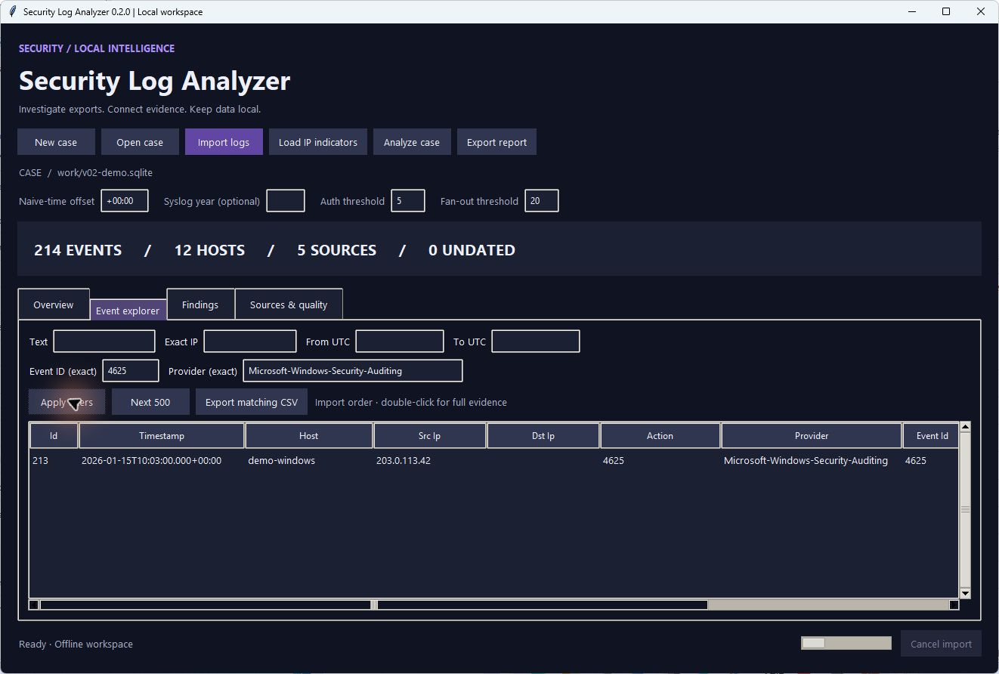

# Windows event and trace support



## Supported now

| Extension | Reader | Platform and limits |
| --- | --- | --- |
| `.evtx` | Windows `EventLogReader` via a fixed local Windows PowerShell command | Windows only; message resources depend on installed providers |
| `.etl` | Windows `tracerpt -of EVTX -lr`, then `EventLogReader` | Windows only; best-effort provider decoding, temporary disk space required |
| `.xml`, `.xml.gz` | Streaming Windows Event XML parser | All platforms; one `Event` or an `Events` root with `Event` children |
| `.log`, `.txt`, `.syslog` | Existing text/Syslog/key-value parser | Line-oriented; unknown formats retained as plain messages |
| `.csv`, `.tsv` | Header-based delimited parser | Common field aliases, including provider and event ID |
| `.jsonl`, `.ndjson` | One object per line | Flat and nested field mapping; see the structured log guide |

Gzip is supported for text/XML formats only. Decompress EVTX/ETL first. This app reads saved files, not live Windows channels or ongoing ETW sessions.

## What is retained

Native event metadata includes time, event ID, provider name or GUID fallback, channel, record ID, computer, severity, process/thread IDs, and available user SID. The case indexes provider, event ID, channel, and record ID as separate columns. Other details remain in retained record JSON/XML. Named `EventData`/`UserData` fields are preserved and common source/destination IP and user names are normalized. Payload values cannot overwrite System metadata.

The event explorer offers exact **Event ID** and **Provider** filters. Text search also covers provider and channel. Double-click an event to view the retained record, including original event XML, payload fields, and decode-warning details. Reports include per-source decode-warning counts. CSV exports include the new metadata columns.

If Windows cannot render a message, the event is retained with available metadata and fields, plus a decode warning. A warning does not prove data was lost, and successful conversion does not prove all provider payloads were decoded. All ETL events have a best-effort conversion warning. A fatal reader error rolls back the entire file; already completed files remain imported. Duplicate detection fingerprints the original file, not the temporary conversion.

## ETL scope

ETL is a container for many kinds of ETW data. Provider manifests/resources may be unavailable, and WPP traces can require TMF/PDB information. This version does not install manifests, resolve symbols, decode packet contents, or supply provider-specific trace schemas. Use the provider's tools when these are required.

The local ETL path converts to temporary EVTX rather than XML because testing found a one-minute discrepancy between `tracerpt` XML timezone offsets and native event UTC times on this machine. The native EVTX reader supplies UTC timestamps. Direct XML imports use the timestamps actually supplied in that XML; the app cannot repair an incorrect upstream timestamp.

Temporary EVTX files are removed on completion, cancellation, and ordinary errors. Allow enough temporary disk space for a full conversion. Native decoding runs off the UI thread. Cancellation terminates the child process and rolls back the current file. The ETL conversion and Windows PowerShell process add overhead; the previous million-row CSV benchmark does not measure native Windows decoding.

## Examples

```powershell
py -3 -m security_log_analyzer import cases/windows.sqlite Security.evtx trace.etl
py -3 -m security_log_analyzer import cases/windows.sqlite samples/windows-demo.xml
py -3 -m security_log_analyzer export cases/windows.sqlite reports/auth.csv --event-id 4625 --provider Microsoft-Windows-Security-Auditing
```

No extra packages or administrator prompt are needed for importing files the current user can read. Enterprise controls can block Windows PowerShell or native tools; the app reports the failure and does not bypass those controls.

## Other formats

CEF/LEEF, IIS/W3C, and nested JSON/arrays are available in v0.3. See [Structured logs](STRUCTURED-LOGS.md) for supported variants and limits. PCAP/PCAPNG, legacy EVT, and ZIP bundle ingestion remain outside scope.

## Microsoft references

- [Get-WinEvent file formats and forward reading](https://learn.microsoft.com/en-us/powershell/module/microsoft.powershell.diagnostics/get-winevent?view=powershell-5.1)
- [Reading ETL with EventLogReader](https://devblogs.microsoft.com/oldnewthing/20201210-00/?p=104536)
- [Tracerpt formats and best-effort mode](https://learn.microsoft.com/en-us/windows-server/administration/windows-commands/tracerpt)
- [Private in-process trace sessions](https://learn.microsoft.com/en-us/windows/win32/etw/configuring-and-starting-a-private-logger-session)

Related format references: [IIS/W3C configuration](https://learn.microsoft.com/en-us/iis/configuration/system.applicationhost/sites/site/logfile/), [IBM LEEF](https://www.ibm.com/docs/en/qradar-on-cloud?topic=leef-overview), and [CEF integration](https://documentation.sailpoint.com/connectors/identityiq/sec_info_mgmt/help/secinfoeventmgmt_guide/common_event_format__cef.html).
